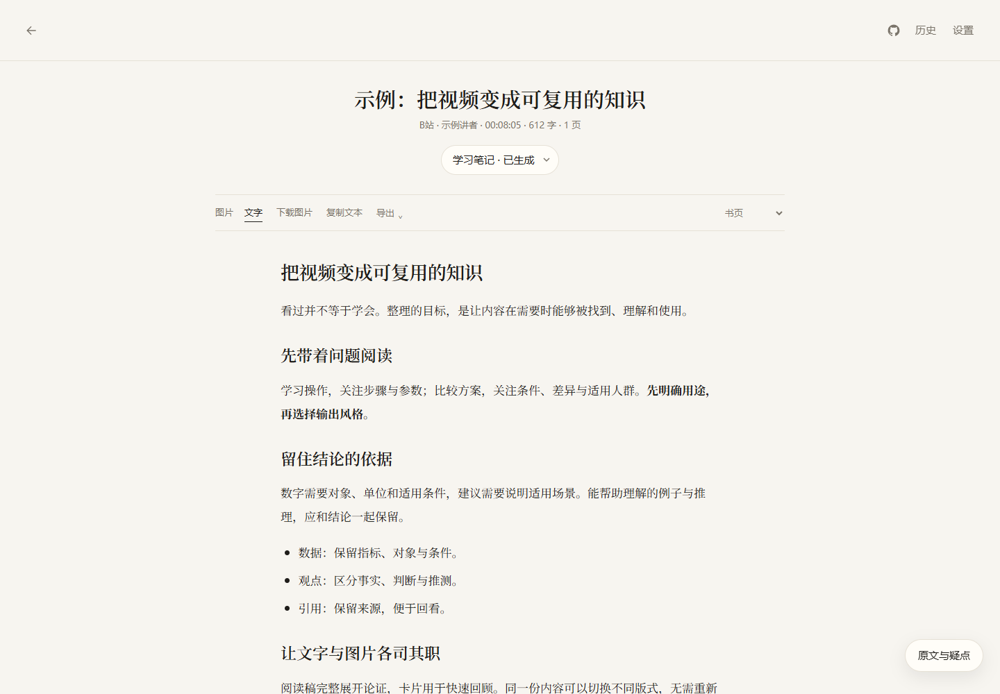
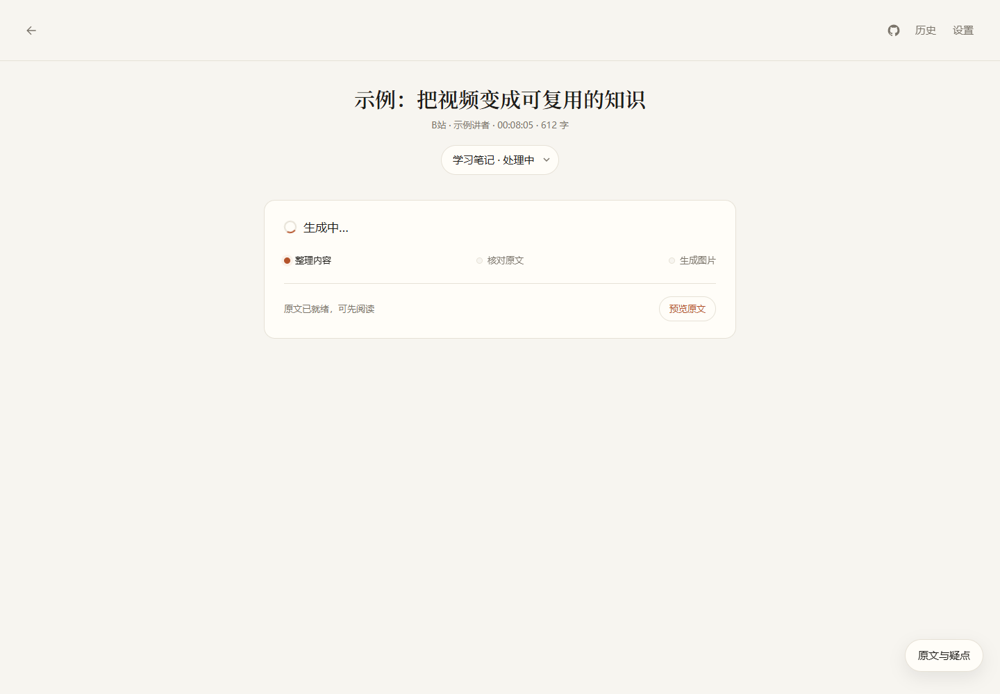
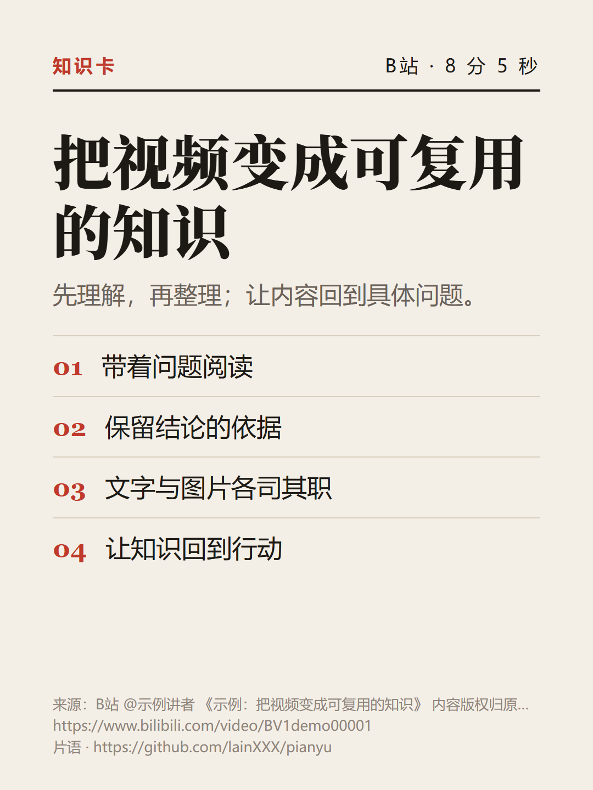
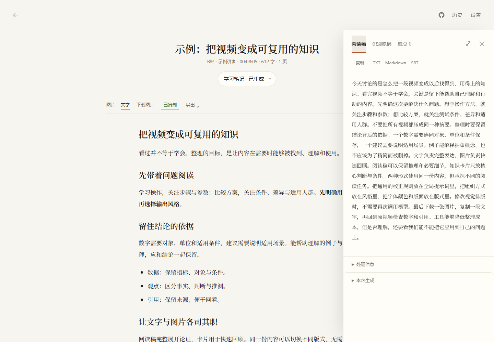
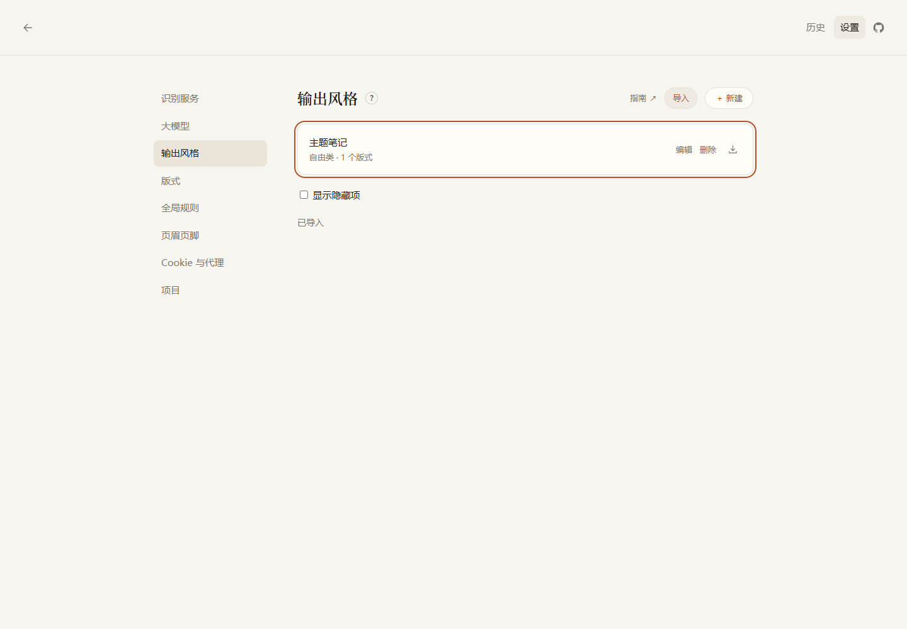
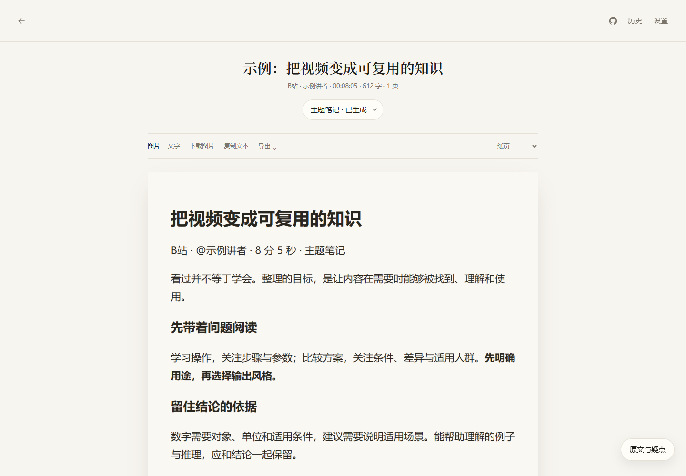

# Pianyu · 片语

[简体中文](README.md) · [English](README.en.md)

Turn videos into readable text.

Pianyu is a video reading tool that runs on your computer. Paste a link, extract the transcript, and turn it into text and images in your chosen style.

| Choose a style | Read the result |
| --- | --- |
|  |  |
| Generation progress | Image layout |
|  |  |

<details>
<summary>Transcript, mobile view, and style import</summary>




| Image reader | Mobile reader | Imported layout |
| --- | --- | --- |
|  |  |  |

</details>

These images use sample content and simulated transcription and AI responses. The pages and PNGs are rendered by the application; they do not demonstrate the quality of real services.

## Features

- Fetch videos and subtitles from Bilibili, Douyin, and YouTube, with speech recognition support.
- Organize content as study notes, comparisons, action lists, and other styles with customizable prompts.
- Read AI output, inspect the transcript and flagged passages, copy text, download images, or export files.
- Create layouts and bind them to output styles. Switch layouts while reusing existing content.
- Import and export style packages containing both prompts and layouts. Each import creates an independent copy.
- Manage transcription services, language models, defaults, platform logins, and local history.

## Create and share styles

Give the [style creation guide](docs/style-guide.en.md) to an AI, describe the content you want and your layout preferences, and ask it to generate a JSON style package containing the prompt and layouts. Select the file under **Settings → Output styles → Import**. The download icon beside each style exports the complete package.

The guide covers content types, prompt variables, template rules, and working examples. No source code changes are needed. The application interface is currently in Chinese.

## Install and run

Development and acceptance testing currently target **Windows with Python 3.12**. Other operating systems have not been verified, and the current dependencies include Windows-specific components.

Install [Python 3.12](https://www.python.org/downloads/), [FFmpeg](https://ffmpeg.org/download.html), and [Microsoft Edge](https://www.microsoft.com/edge). Make sure `python` and `ffmpeg` are available in your terminal. Download or clone this repository, then open PowerShell in its directory:

```powershell
py -3.12 -m venv .venv
.\.venv\Scripts\python.exe -m pip install --upgrade pip
.\.venv\Scripts\python.exe -m pip install -r requirements.txt
.\.venv\Scripts\python.exe -m playwright install chromium
.\.venv\Scripts\python.exe scripts/download_vad.py
.\.venv\Scripts\python.exe -m vtx.server
```

Open <http://127.0.0.1:8765>. For later launches, double-click `start.bat`; it uses the existing `.venv` and does not install dependencies.

1. Add a transcription service and a language model in Settings, enter your own API keys, and test the connections.
2. If needed, select a platform's browser login option and sign in through its dedicated browser window. Pianyu saves that platform's cookies automatically.
3. Return to the home page, paste a video link, choose an output style, and start generating.

Image rendering prefers Edge and can also use Chromium installed by Playwright. Platform login requires a visible browser window.

The download script saves the Silero VAD model used for speech segmentation to `models/silero_vad.onnx`. The model is not distributed with the source code. Initial setup requires internet access; subsequent launches reuse the local file. See [third-party notices](THIRD_PARTY_NOTICES.md) for its source and license.

If the default port is occupied, stop the duplicate server process or choose another port:

```powershell
$env:VTX_PORT = "8766"
.\.venv\Scripts\python.exe -m vtx.server
```

Open the corresponding port manually. The address opened by `start.bat` is fixed to port `8765`.

## Configuration and data

Use Settings to configure the application. Provider presets include links to official websites, API key consoles, and documentation. Preset endpoints and model names are editable; availability depends on the provider and your account permissions.

| Location | Contents |
| --- | --- |
| `config/app.json` | Runtime options, including port, browser, and proxy |
| `config/services/` | Transcription and model services, with default selections |
| `config/secrets/` | API keys |
| `config/prompts/` | Global rules and output styles |
| `config/layouts/` | Layouts and image framing |
| `config/cookies/` | Platform login cookies |
| `work/` | Task history, download cache, generated files, and dedicated login browser profiles |
| `logs/` | Application and error logs |

These local directories are excluded from Git. Keys, cookies, and browser profiles are stored in local files without application-level encryption; restrict access and take care when backing them up. Transcription sends audio to the selected service. AI processing sends the title, transcript, and relevant prompts. Check each service's data policy before use.

Set `VTX_CONFIG_DIR` and `VTX_WORK_DIR` to change the directories. Environment variables take precedence over `config/app.json`. On first launch, legacy configuration is migrated without removing the old files or overwriting existing new configuration. Restart after changing the listening address, port, or browser runtime options.

See the [configuration reference](vtx/configuration/README.md) for individual fields. Rotating JSON Lines logs, `app.jsonl` and `errors.jsonl`, record stages, durations, and correlation IDs. They do not record request bodies, prompts, cookies, or keys.

## Costs and scope

The software is provided under the MIT license. Third-party transcription, language model, and proxy services may charge fees directly. Regenerating content may make additional service calls. Switching the layout of existing content happens locally.

Pianyu is intended for one person using a local computer. It listens on `127.0.0.1` by default and does not provide multi-user authentication; do not expose it directly to the internet. Videos are currently limited to five hours each. Platform restrictions, login state, regional availability, and interface changes may affect downloads. Saved cookies do not guarantee that a session remains valid.

Transcription and AI output can contain errors. Check names, numbers, and quotations against the original video. Only process content you are authorized to access and use, and follow platform rules. The software license does not grant rights to videos, subtitles, or third-party services.

## Development

```text
vtx/
  api/               Request models and settings endpoints
  configuration/     Configuration storage and migration
  browser_login/     Dedicated browser login
  web/               Pages and frontend scripts
  server.py          Application assembly, jobs, and result endpoints
  pipeline.py        Download, transcription, quality checks, and output
  providers.py       Provider presets and official links
  style_packages.py  Style package validation, import, and export
  observability.py   Structured logging
tests/
  unit/              Module and API tests
  integration/       Browser, rendering, and real-service tests
docs/                Architecture documentation and product screenshots
```

See the [architecture guide](docs/architecture.md) for module responsibilities and extension points.

```powershell
.\.venv\Scripts\python.exe -m pytest tests/unit -q
.\.venv\Scripts\python.exe -m pytest tests/integration/test_provider_login_ui.py -m integration -q
```

The default pytest configuration excludes integration tests. The browser test shown above uses installed Edge and isolated simulated services. Other integration tests may access websites, download models, or call paid services; read the relevant test before running it. Passing tests with simulated services does not establish that a real platform or model works.

See [Contributing](CONTRIBUTING.md) to participate and [Security](SECURITY.md) to report a security issue.

## License

[MIT](LICENSE) · Copyright (c) 2026 Pianyu contributors.

MIT covers original project code. Third-party dependencies, models, fonts, and platform content remain subject to their own licenses and terms. See [third-party notices](THIRD_PARTY_NOTICES.md).
