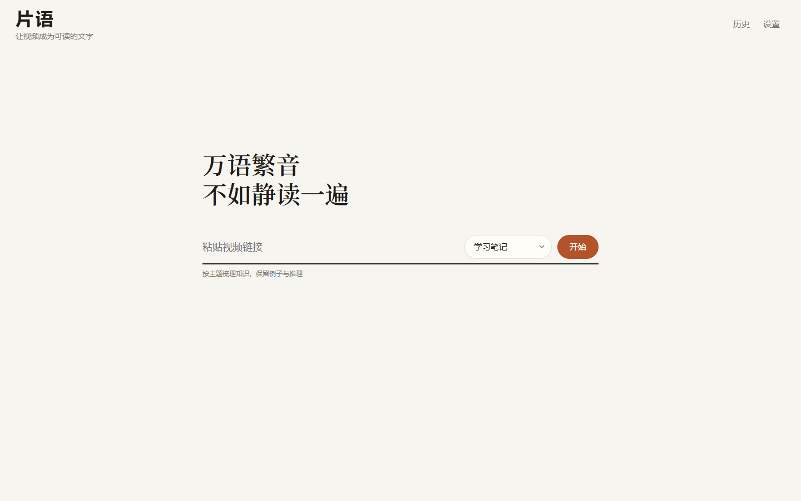

# 片语

让视频成为可读的文字。

片语是一款在本机运行的视频阅读工具：粘贴链接，提取原文，再按所选风格整理为文字与图片。



## 功能

- 获取 B站、抖音、YouTube 视频与字幕，支持语音识别。
- 将内容整理为学习笔记、测评对比、行动清单等风格，支持自定义提示词。
- 阅读 AI 输出、查看原文与疑点，复制文本、下载图片或导出文件。
- 自定义版式并绑定输出风格，切换版式复用已有内容。
- 管理识别服务、大模型、默认选项与平台登录，保留本地历史。

## 安装与启动

目前以 **Windows + Python 3.12** 为开发和验收环境。其他系统尚未完成验证；当前依赖包含 Windows 专用组件。

先安装 [Python 3.12](https://www.python.org/downloads/)、[FFmpeg](https://ffmpeg.org/download.html) 和 [Microsoft Edge](https://www.microsoft.com/edge)。确认 `python` 与 `ffmpeg` 可在终端执行。在下载或克隆的项目目录打开 PowerShell：

```powershell
py -3.12 -m venv .venv
.\.venv\Scripts\python.exe -m pip install --upgrade pip
.\.venv\Scripts\python.exe -m pip install -r requirements.txt
.\.venv\Scripts\python.exe -m playwright install chromium
.\.venv\Scripts\python.exe scripts/download_vad.py
.\.venv\Scripts\python.exe -m vtx.server
```

打开 <http://127.0.0.1:8765>。后续可以双击 `start.bat`；该脚本使用已有 `.venv`，不会安装依赖。

1. 在设置中添加识别服务与大模型，填写自己的 API Key，并测试连接。
2. 按需选择平台的“网页登录”，在独立浏览器中完成登录；程序自动保存该平台的 Cookie。
3. 回到首页，粘贴视频链接并选择输出风格，开始生成。

图片渲染优先使用 Edge，也可使用 Playwright 安装的 Chromium。网页登录需要可见浏览器窗口。

下载脚本将语音分段所需的 Silero VAD 模型保存到 `models/silero_vad.onnx`；该文件不随源码分发。首次准备环境需要联网，后续启动复用本地文件。模型来源及许可见 [第三方说明](THIRD_PARTY_NOTICES.md)。

如默认端口被占用，停止重复启动的进程，或指定其他端口：

```powershell
$env:VTX_PORT = "8766"
.\.venv\Scripts\python.exe -m vtx.server
```

此时手动访问对应端口；`start.bat` 打开的地址固定为 `8765`。

## 配置与数据

配置可在设置页修改，厂商选项附有官方、密钥申请和文档链接。预设地址与模型名可编辑，实际可用性以厂商和账号权限为准。

| 位置 | 内容 |
| --- | --- |
| `config/app.json` | 端口、浏览器、代理等运行参数 |
| `config/services/` | 识别与模型服务、默认选择 |
| `config/secrets/` | API Key |
| `config/prompts/` | 全局规则与输出风格 |
| `config/layouts/` | 版式及画框 |
| `config/cookies/` | 平台登录 Cookie |
| `work/` | 任务历史、下载缓存、产物及独立浏览器登录资料 |
| `logs/` | 运行与错误日志 |

这些本机目录不提交 Git。密钥、Cookie 和浏览器资料保存在本机文件中，未作应用层加密，请限制文件访问并谨慎备份。识别会向所选服务发送音频，AI 整理会发送标题、原文及相关提示词；使用前请确认服务的数据政策。

`VTX_CONFIG_DIR`、`VTX_WORK_DIR` 可改变目录；环境变量优先于 `config/app.json`。首次启动兼容迁移旧配置，保留旧文件且不覆盖已有新配置。修改监听地址、端口或浏览器运行参数后需重启。

详细字段见 [配置说明](vtx/configuration/README.md)。日志按 JSON 行记录阶段、耗时与关联 ID，写入 `app.jsonl`、`errors.jsonl` 并轮转；不记录请求正文、提示词、Cookie 和密钥。

## 费用与使用范围

软件按 MIT 协议提供；语音识别、大模型、网络代理等第三方服务可能收费，费用由所选服务商收取。重新生成内容可能产生额外调用；单纯切换已有内容的版式在本地完成。

项目面向单人本机使用，默认仅监听 `127.0.0.1`，未提供多用户鉴权，请勿直接暴露到公网。当前单个视频时长上限为 5 小时。平台风控、登录状态、地区限制与接口变更均可能影响获取；保存 Cookie 不代表登录持续有效。

识别和 AI 输出可能有误，专有名词、数字及引用请结合原视频核对。请仅处理有权访问和使用的内容，并遵守平台规则；软件许可证不授予视频、字幕或第三方服务的使用权。

## 开发

```text
vtx/
  api/               请求模型与设置接口
  configuration/     配置存储与迁移
  browser_login/     独立浏览器登录
  web/               页面与前端脚本
  server.py          应用组装、任务与结果接口
  pipeline.py        下载、识别、质检与输出流程
  providers.py       厂商预设与官方链接
  observability.py   结构化日志
tests/
  unit/              模块与接口测试
  integration/       浏览器、渲染与真实服务测试
docs/                架构说明与产品截图
```

模块职责与扩展方式见 [架构说明](docs/architecture.md)。

```powershell
.\.venv\Scripts\python.exe -m pytest tests/unit -q
.\.venv\Scripts\python.exe -m pytest tests/integration/test_provider_login_ui.py -m integration -q
```

默认 pytest 配置跳过集成测试。上述浏览器测试使用已安装的 Edge 与隔离的模拟服务；其他 `integration` 用例可能访问网站、下载模型或调用付费服务，运行前请阅读对应测试。替身测试通过不等于真实平台或模型已验证。

参与开发见 [贡献指南](CONTRIBUTING.md)，安全问题见 [安全说明](SECURITY.md)。

## 许可证

[MIT](LICENSE) · Copyright (c) 2026 片语 contributors。

MIT 仅覆盖项目原创代码。第三方依赖、模型、字体及平台内容遵循各自许可证与条款，见 [第三方说明](THIRD_PARTY_NOTICES.md)。
